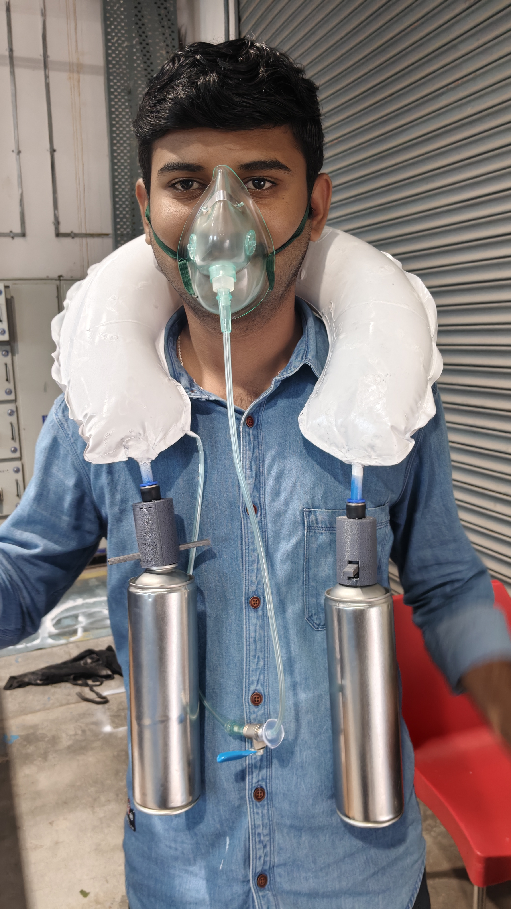
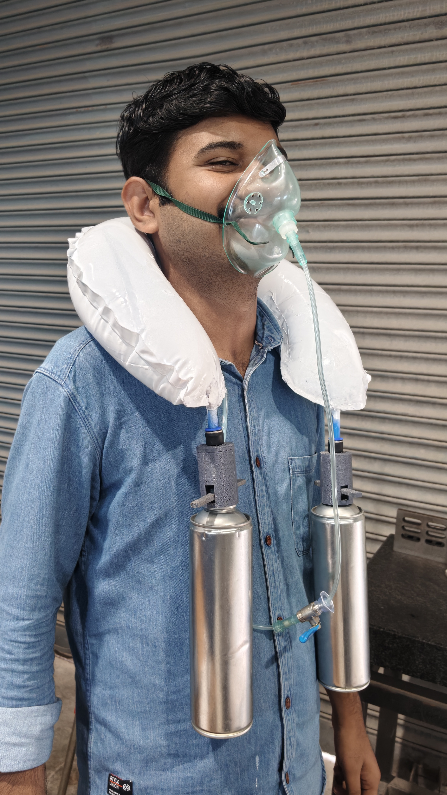
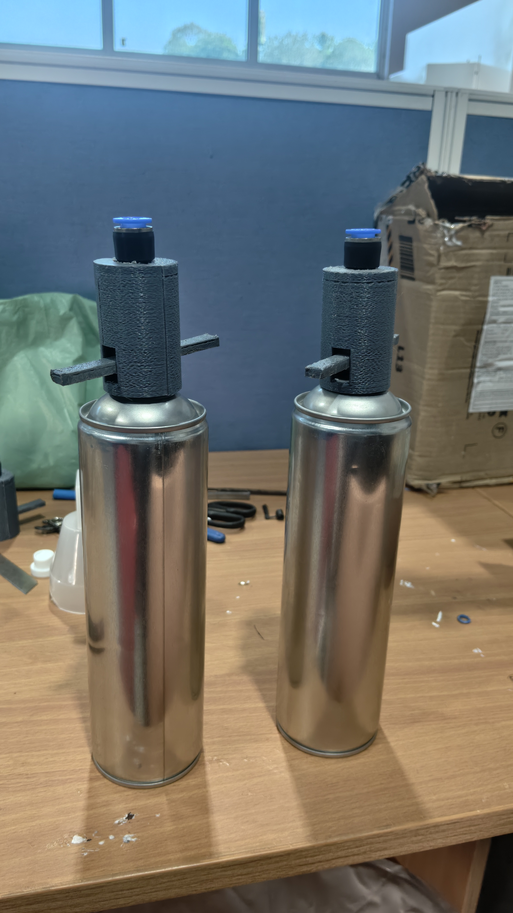
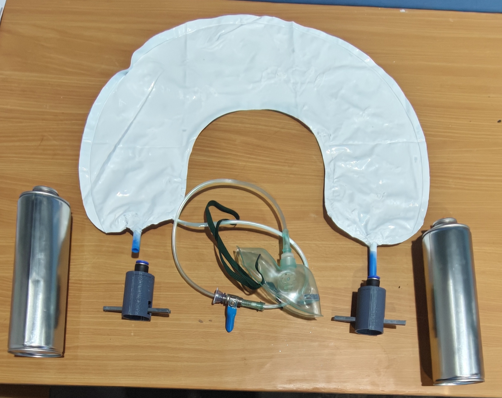

# Integrated Foldable Inflatable Neck Support Cushion with Regulated Portable Oxygen Delivery System

> **A wearable, lightweight, and rapidly deployable emergency oxygen and cervical support device designed for high-altitude, military, and hypoxia-mitigation operations.**

---

## 📌 Overview
Operating in high-altitude environments often exposes personnel to reduced atmospheric oxygen concentrations, leading to severe physiological hypoxia, dizziness, and cognitive impairment. Traditional oxygen delivery setups are bulky, heavy, and lack integrated structural neck support. 

This project—developed during the **Designovation Program at IIT Jammu** by Anand Thakare, Arjun P., and Prajwal Jinde—presents an innovative, patent-pending solution that integrates **cervical stabilization** and **regulated supplemental oxygen delivery** into a single, compact, wearable device. 

---

## 📸 Project Gallery & Prototypes (Sets 1 to 4)

<table>
  <tr>
    <td align="center"><b>Set 1: Front View</b> </td>
    <td align="center"><b>Set 2: Side View</b> </td>
  </tr>
  <tr>
    <td align="center"><b>Set 3: Canister Prototyping</b> </td>
    <td align="center"><b>Set 4: Product Prototyping</b> </td>
  </tr>
</table>
---

## 🎥 Project Videos & Demonstration

### How-To-Use Demonstration
<video width="100%" controls>
  <source src="assets/video/Prana_How to use (1).mp4" type="video/mp4">
  Your browser does not support the video tag.
</video>

### Research & Prototyping Journey
<video width="100%" controls>
  <source src="assets/video/research and prototyping product.mp4" type="video/mp4">
  Your browser does not support the video tag.
</video>

## 🚀 Key Features & Working Principle
* **Dual-Function Inflatable Cushion:** The U-shaped neck cushion functions simultaneously as a cervical support collar and an intermediate oxygen flow chamber, efficiently utilizing stored gas for both inflation and respiratory assistance.
* **Lever-Operated Canister Actuation:** Features custom-machined Aluminium 6061-T6 canisters coupled with a threaded housing and lever mechanism that punctures/actuates the valve securely while remaining mounted.
* **Dual-Stage Pressure Regulation:** 
  1. *Primary Regulator:* Reduces pressure from ~150 bar to 5–8 bar to inflate the bladder cushion.
  2. *Secondary Regulator & Flow Valve:* Steps down pressure to a breathable level with adjustable flow rates (0–15 L/min) delivered via a medical-grade silicone mask.
* **Rapid Deployment:** Eliminates the need for separate heavy backpacks or bulky tanks, making it ideal for military personnel, mountaineers, rescue teams, and miners.

---

## 🛠️ System Specifications

| Component / Parameter | Specification / Material |
| :--- | :--- |
| **Outer Pillow Cover** | Ripstop Nylon (high tear strength & water repellency)|
| **Inner Bladder** | 420D TPU-coated Nylon|
| **Oxygen Canisters** | Aluminium 6061-T6 Alloy (stores medical-grade oxygen up to 150 bar)|
| **Delivery System** | Flexible silicone tubing & medical-grade silicone mask|
| **Technology Readiness** | TRL 4 (Functional prototype validated through testing)|

---

## 👥 The Team (Designovation 2026)
* **Prajwal Jinde** – Aerospace Engineering, MIT ADT University, Pune, prajwaljinde03@gmail.com
* **Anand Thakare** – Manufacturing Engineering & Industrial Management, COEP Technological University, anandthakare537@gmail.com
* **Arjun P.** – Mechanical Engineering, College of Engineering, Trivandrum, arjunpkgm04@gmail.com
